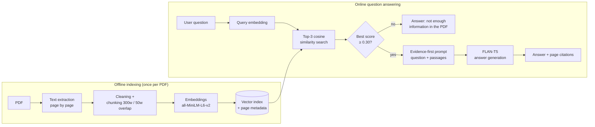

# 📚 Intelligent Academic Assistant — Document-Based Question Answering with RAG

[](https://colab.research.google.com/github/YOUR_USERNAME/YOUR_REPO/blob/main/notebooks/IE624_RAG_Academic_Assistant.ipynb)


A chatbot that answers questions **from one academic PDF** (lecture notes, a research paper, a thesis)
using **Retrieval-Augmented Generation (RAG)**. Every answer cites the **page** it came from, and the
assistant says so when the PDF does not contain the answer. After a PDF is uploaded it **suggests
questions you can ask**, NotebookLM-style.

> Course project for **IE624**, IIT Bombay (Academic Year 2026–27).
>
> 📄 [Final report](docs/IE624_Final_Project_Report.pdf) · 📊 [Presentation slides](docs/IE624_Presentation_Slides.pdf)

---

## Table of contents
- [Problem statement](#problem-statement)
- [Features](#features)
- [How it works: the RAG pipeline](#how-it-works-the-rag-pipeline)
- [Tech stack](#tech-stack)
- [Repository structure](#repository-structure)
- [Quick start](#quick-start)
- [Configuration](#configuration)
- [Evaluation](#evaluation)
- [Limitations and future work](#limitations-and-future-work)
- [References](#references)
- [Authors](#authors)

---

## Problem statement
Students often have to search long PDFs to find a definition, an explanation or a comparison.
Keyword search misses passages that say the same thing in different words. A general-purpose chatbot
may give answers that are **not supported by the student's own material**.

**Goal:** build a lightweight, document-grounded assistant that retrieves the relevant passages from a
PDF, generates an answer **only from those passages**, and shows **traceable evidence** (page and excerpt).

**Research question:** *To what extent can a lightweight RAG pipeline improve the correctness,
faithfulness and traceability of answers about a fixed academic document, compared with the same
language model without retrieved context?*

---

## Features
- 📄 **Single-document mode:** upload one PDF; all answers come from it. A new upload replaces it.
- 💡 **Suggested questions:** 8 clickable questions generated from the PDF (factual, why/how,
  comparison, findings), each checked to be answerable from the document.
- 🔎 **Semantic search:** finds passages by meaning, not exact words (sentence embeddings + cosine similarity).
- 📌 **Page citations:** source, page range, similarity score and excerpt for every answer.
  Citations are built from stored metadata, never invented by the model.
- 🛑 **Abstention:** if nothing relevant is retrieved, the assistant says the document does not
  contain enough information instead of guessing.
- ⚖️ **Baseline comparison:** shows the same model's answer *without* retrieval next to the RAG answer.
- 📊 **Evaluation toolkit:** Recall@3, MRR, correctness, faithfulness, citation accuracy, abstention
  success, and response time.
- 🖥️ **Gradio web app** plus a notebook/console fallback.

---

## How it works: the RAG pipeline



| Stage | What happens | Code |
|---|---|---|
| **R**etrieval: indexing | Extract text per page (PyMuPDF), clean it, split into 300-word chunks with 50-word overlap, embed each chunk, store vectors with filename and page range | `extract_pages`, `chunk_document`, `DocumentIndex.build` |
| **R**etrieval: search | Embed the question, score all chunks by cosine similarity, take the top 3 | `DocumentIndex.search` |
| **A**ugmentation | Insert the retrieved passages into a prompt that says *answer only from this context, otherwise say there is not enough information* | `build_rag_prompt` |
| **G**eneration | A pretrained text-to-text model (FLAN-T5) writes the answer | `Generator.generate` |
| Presentation | Answer, page citations and excerpts from stored metadata | `format_sources_markdown` |
| Suggestions | Representative, diverse chunks (maximal marginal relevance) → one model-written question each → kept only if retrieval finds its source passage | `suggest_questions` |

**Prompt template**
```text
Role: You are an academic study assistant.
Task: Answer the user's question using only the provided context.
Limitations: If the context does not support an answer, reply exactly:
             "The available documents do not contain enough information to answer this question."
Style: Give a concise, clear explanation in complete sentences. Do not invent citations.

Question: <user question>
Context: [1] (file.pdf, pp. 4–5) <passage> ...
Answer:
```

---

## Tech stack
| Component | Tool |
|---|---|
| PDF text extraction | PyMuPDF (pypdf as fallback) |
| Embeddings | `sentence-transformers/all-MiniLM-L6-v2` |
| Vector search | NumPy (cosine similarity on normalised vectors) |
| Answer generation | `google/flan-t5-base` (Hugging Face Transformers) |
| Interface | Gradio |
| Evaluation | pandas |
| Environment | Google Colab (T4 GPU recommended; CPU works) |

---

## Repository structure
```
├── notebooks/
│   └── IE624_RAG_Academic_Assistant.ipynb   # main notebook: run top to bottom in Colab
├── rag_core.py          # pipeline: extraction, chunking, embeddings, retrieval, prompt, generation, suggestions
├── app.py               # Gradio chat app (single PDF, clickable suggestions, source panel)
├── evaluate.py          # RAG vs no-retrieval baseline evaluation and metrics
├── data/
│   ├── eval_questions_template.csv          # 25-row template for your own PDF
│   └── eval_questions_ie624_report.csv      # filled example set (for the pre-project report PDF)
├── requirements.txt
├── LICENSE
└── README.md
```

---

## Quick start

### Option A: Google Colab (recommended)
1. Click the **Open in Colab** badge above (or upload the notebook from `notebooks/`).
2. *Runtime ▸ Change runtime type ▸ T4 GPU*.
3. Run the cells in order. In §1, upload **one** PDF.
4. In §5 you'll see the suggested questions; ask one with `ask(suggestions[0])`.
5. In §6, launch the chat app (`share=True` gives a public link).

### Option B: run locally
```bash
git clone https://github.com/YOUR_USERNAME/YOUR_REPO.git
cd YOUR_REPO
pip install -r requirements.txt

python app.py --pdf path/to/your.pdf            # web app at http://127.0.0.1:7860
python app.py --pdf path/to/your.pdf --console  # text-only mode
```

### Use from Python
```python
from rag_core import RAGConfig, AcademicAssistant, build_or_load_index, set_single_pdf

config = RAGConfig()
set_single_pdf("lecture_notes.pdf", "documents", "index")
index = build_or_load_index("documents", "index", config)
assistant = AcademicAssistant(index, config)

print(assistant.suggested_questions())
ans = assistant.ask("What is overfitting?")
print(ans.answer)
for s in ans.sources:
    print(s["source"], s["pages"], round(s["score"], 2))
```

---

## Configuration
All settings live in `RAGConfig` (`rag_core.py`):

| Setting | Default | Meaning |
|---|---|---|
| `embedding_model` | `sentence-transformers/all-MiniLM-L6-v2` | sentence-embedding model |
| `chunk_size_words` / `chunk_overlap_words` | 300 / 50 | chunk length and overlap |
| `top_k` | 3 | passages retrieved per question |
| `min_similarity` | 0.30 | below this best score the assistant abstains (tune with `threshold_sweep`) |
| `generator_model` | `google/flan-t5-base` | answer model (e.g. `google/flan-t5-large`, `Qwen/Qwen2.5-1.5B-Instruct`) |
| `max_input_tokens` / `max_new_tokens` | 1024 / 200 | prompt and answer length limits |
| `n_suggestions` | 8 | number of suggested questions |

---

## Evaluation
The system is compared against a **no-retrieval baseline** (same model and decoding, question only).

| Metric | How it is measured |
|---|---|
| Recall@3 | share of answerable questions whose gold page appears in the top-3 retrieved chunks |
| MRR | mean reciprocal rank of the first relevant chunk |
| Answer correctness | manual rubric: 0 incorrect, 1 partial, 2 correct |
| Faithfulness | manual rubric: 0 unsupported, 1 partly supported, 2 fully supported by the retrieved evidence |
| Citation accuracy | share of answers whose cited page actually supports the claim |
| Abstention success | share of unanswerable questions where the system says the evidence is insufficient |
| Response time | seconds from question to answer |

**Question set:** 25 questions: 8 factual, 7 conceptual, 5 comparison, 5 unanswerable. Columns:
`id, question, type, answerable, expected_answer, source_file, source_pages`.

```python
from evaluate import run_evaluation, summarise, breakdown_by_type, threshold_sweep
run_evaluation(assistant, "data/eval_questions_template.csv", "results_raw.csv")
# score the manual columns, save as results_scored.csv, then:
summarise("results_scored.csv")
```

### Results
Measured on a 25-question set (8 factual, 7 conceptual, 5 comparison, 5 unanswerable) about one
12-page PDF, with the default configuration (FLAN-T5-base, k = 3, threshold 0.30).

| Metric | RAG | Baseline (no retrieval) |
|---|---|---|
| Recall@3 (answerable) | 0.90 | n/a |
| MRR | 0.82 | n/a |
| Answer correctness (0–2) | 0.50 | 0.00 |
| Faithfulness (0–2, answered questions) | 1.43 | n/a |
| Citation accuracy (answered questions) | 0.79 | n/a |
| Abstention success (unanswerable) | 0.80 | 0.00 |
| False abstention (answerable) | 0.30 | 0.20 |
| Mean response time (s) | 0.68 | 0.35 |

Retrieval finds the evidence for most questions, and grounding turns the baseline's invented answers into
partly correct, checkable ones. The small generator is the main bottleneck: conceptual questions scored 0.

---

## Limitations and future work
**Limitations**
- Works on text-based PDFs; scanned pages, complex tables, figures and equations are not handled reliably.
- FLAN-T5-base is small: answers are short and may simplify complex comparisons.
- Semantic similarity does not guarantee that a retrieved passage contains the answer; always check the cited page.
- The evaluation set is small, so results are exploratory.

**Future work:** hybrid keyword + vector retrieval, a cross-encoder reranker, OCR for scanned PDFs,
conversation history, larger answer models, multiple documents, and a larger benchmark.

---

## References
1. Lewis, P. et al. (2020). *Retrieval-Augmented Generation for Knowledge-Intensive NLP Tasks.* NeurIPS. [arXiv:2005.11401](https://arxiv.org/abs/2005.11401)
2. Karpukhin, V. et al. (2020). *Dense Passage Retrieval for Open-Domain Question Answering.* EMNLP. [arXiv:2004.04906](https://arxiv.org/abs/2004.04906)
3. Reimers, N. & Gurevych, I. (2019). *Sentence-BERT: Sentence Embeddings using Siamese BERT-Networks.* EMNLP-IJCNLP. [arXiv:1908.10084](https://arxiv.org/abs/1908.10084)
4. Hugging Face Transformers: https://huggingface.co/docs/transformers
5. Sentence Transformers: https://www.sbert.net

---

## Authors
- **Apurbo Talukder** (25M1540)
- **Sunil Kumar** (25M1539)

Submitted to **Prof. Manjesh Kumar Hanawal**, Industrial Engineering and Operations Research, IIT Bombay.

## License
Released under the [MIT License](LICENSE).
